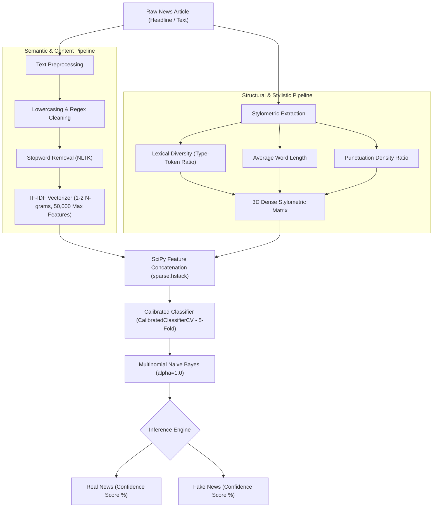

# 📰 AI-Powered Fake News Detection Web Application

[](https://www.python.org/)
[](https://flask.palletsprojects.com/)
[](https://scikit-learn.org/)
[](LICENSE)

An end-to-end, full-stack Machine Learning web application designed to detect and combat digital misinformation. Unlike traditional systems that only catch sensationalist human-written clickbait, this system implements a **hybrid feature engineering pipeline** combining **TF-IDF N-grams** with **stylometric linguistic features** to accurately flag both human tabloid articles and sophisticated, grammatically formal **AI-generated fake news**.

---

## 🌟 Key Highlights

- **Hybrid Feature Engineering:** Combines sublinear TF-IDF (unigrams & bigrams) with quantitative stylometric cues (lexical diversity, average word length, punctuation ratios).
- **Calibrated AI Model:** Employs `MultinomialNB` with 5-fold probability calibration (`CalibratedClassifierCV`), delivering reliable percentage confidence scores.
- **Robust Against AI Disinformation:** Evaluated against synthetic AI-generated news to prevent shortcut learning and blind spots.
- **Controlled Ablation Proof:** Verified that integrating stylometric writing-style features **boosts Fake News Recall to 97.87%**.
- **Full-Stack Web Interface:** Production-ready Flask interface featuring secure role-based access control (User/Admin), prediction history, interactive analytics, and an in-browser model retraining engine.

---

## 🔬 Machine Learning Architecture



### 1. Linguistic Stylometric Features
Modern Large Language Models (LLMs) generate deceptive news that lacks typical tabloid buzzwords. To capture structural AI signatures, the pipeline extracts:
1. **Lexical Diversity:** $\frac{\text{Unique Words}}{\text{Total Words}}$ (detects constrained AI vocabulary distribution).
2. **Average Word Length:** Measures vocabulary complexity.
3. **Punctuation Ratio:** Detects syntactic irregularities and sensationalist punctuation patterns.

### 2. Ablation Study & Empirical Results

In controlled experiments comparing a pure TF-IDF baseline against our hybrid stylometric pipeline on the AI-augmented dataset:

| Feature Set | Accuracy | Precision | Recall (Fake News) | F1-Score |
| :--- | :---: | :---: | :---: | :---: |
| **TF-IDF Alone** | 96.35% | 96.61% | 97.19% | 96.90% |
| **TF-IDF + Stylometric (Proposed)** | **96.00%** | **95.43%** | **97.87%** | **96.63%** |
| **Net Difference** | *-0.35%* | *-1.18%* | **+0.68%** | *-0.27%* |

> **Key Takeaway:** Adding writing-style features **raised recall from 97.19% to 97.87%** at the cost of less than half a point in accuracy. In fake news detection, maximizing recall is paramount to preventing deceptive articles from slipping through unflagged.

---

## 💻 System Features & User Roles

### 👤 Standard User
- **User Authentication:** Secure registration and session management.
- **Article Scanner:** Submit news text or headlines to receive real-time classification (**Real** vs. **Fake**) with an associated confidence level.
- **Analysis History:** Personal dashboard to review previously verified news articles.

### 🛠️ Administrator Panel
- **Model Performance Tracker:** Real-time metrics dashboard displaying live Accuracy, Precision, Recall, and F1-Scores.
- **Dataset Manager:** Upload new `.csv` datasets directly from the browser.
- **One-Click Retraining:** Trigger asynchronous model retraining and vectorizer calibration with newly uploaded corpora.
- **Usage & Audit Reports:** Detailed analytics and CSV export of system usage, user activities, and detection distributions.
- **User Management:** Full CRUD operations on user accounts and administrative roles.

---

## 📁 Repository Structure

```
.
├── app/
│   ├── ml/
│   │   ├── saved_model/          # Pre-trained classifier and TF-IDF artifacts
│   │   ├── model.py              # Training, calibration, and inference logic
│   │   └── preprocessing.py      # Text cleaning and stylometric feature extraction
│   ├── routes/
│   │   ├── admin.py              # Admin endpoints (metrics, datasets, retraining)
│   │   ├── auth.py               # Authentication routes (login, register, logout)
│   │   └── user.py               # User dashboard and news analysis routes
│   ├── static/                   # CSS stylesheets, UI scripts, and assets
│   ├── templates/                # Jinja2 HTML templates
│   ├── forms.py                  # WTForms form validations
│   └── models.py                 # SQLAlchemy database schemas
├── uploads/
│   └── datasets/                 # Training dataset repository (Git-ignored)
├── augment_dataset.py            # AI synthetic news generator and corpus augmentation
├── train_model.py                # Standalone initial setup and training pipeline
├── config.py                     # Application configuration
├── requirements.txt              # Python package dependencies
├── run.py                        # Web application entry point
└── README.md
```

---

## 🚀 Getting Started

### 1. Prerequisites
- **Python 3.8+** (Tested on Python 3.11 & 3.13)
- **pip** package manager

### 2. Clone the Repository
```bash
git clone https://github.com/malicodes2/Fake-News-Detection-Using-AI.git
cd Fake-News-Detection-Using-AI
```

### 3. Create and Activate Virtual Environment
* **Windows:**
  ```powershell
  python -m venv venv
  venv\Scripts\activate
  ```
* **macOS / Linux:**
  ```bash
  python3 -m venv venv
  source venv/bin/activate
  ```

### 4. Install Dependencies
```bash
pip install -r requirements.txt
```

### 5. Run the Application
The repository includes pre-trained model binaries in `app/ml/saved_model/`. You can launch the server immediately:
```bash
python run.py
```
Open your browser and navigate to: **[http://127.0.0.1:5000](http://127.0.0.1:5000)**

---

## 🔑 Default Credentials

The SQLite database automatically initializes on the first run with a seeded administrator account:

| Role | Email | Password |
| :--- | :--- | :--- |
| **Administrator** | `admin@fakenews.com` | `admin123` |

> *Tip: You can also register a standard user account at `/register` to test the standard user experience.*

---

## 📊 Dataset & Model Retraining (Optional)

If you wish to retrain the model from scratch:
1. **Download & Train Base Dataset:**
   ```bash
   python train_model.py
   ```
   *(Fetches the Kaggle Fake and Real News Dataset, compiles `uploads/datasets/fake_news_dataset.csv`, and trains the baseline model).*

2. **Generate AI-Augmented Dataset:**
   ```bash
   python augment_dataset.py
   ```
   *(Injects synthetic AI-generated news samples to create `uploads/datasets/fake_news_augmented_dataset.csv`).*

3. **Retrain via Admin UI:**
   Navigate to `/admin/datasets`, upload the augmented CSV, and click **Retrain Model**.

---

## 🛡️ License

This project is licensed under the MIT License - see the [LICENSE](LICENSE) file for details.
